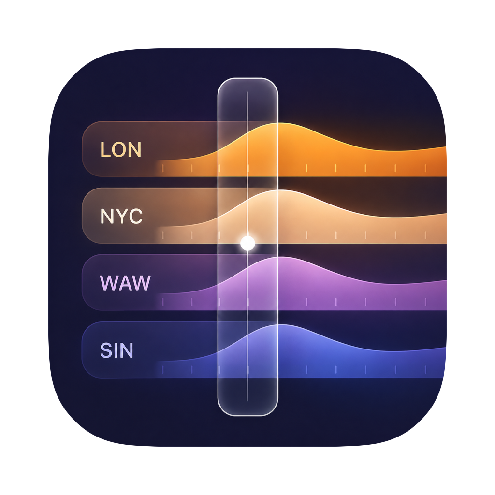
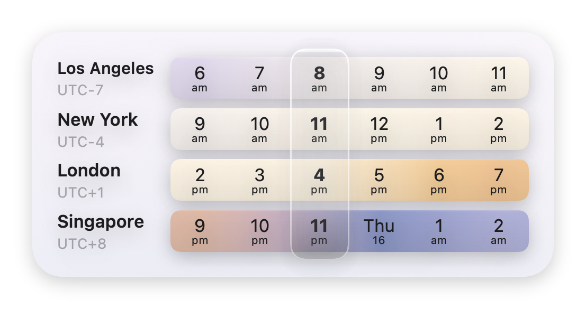
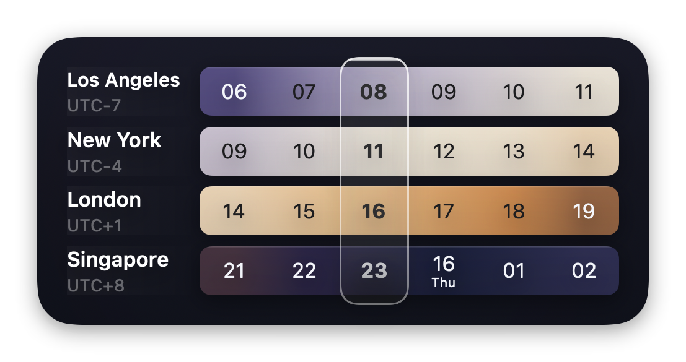

<p align="center">
  
</p>

<h1 align="center">Time Strip</h1>

<p align="center">
  A world clock widget for Mac, iPhone and iPad, with the hours aligned across cities.
</p>

<p align="center">
  <a href="https://apps.apple.com/app/id6815261588">
    
  </a>
</p>

<p align="center">
  <a href="https://github.com/lysyi3m/time-strip/actions/workflows/ci.yml">
    
  </a>
</p>

<p align="center">
  
  
</p>

Each city has a row of hours, shaded from day to night. A single marker shows the current time
across every row, so you can compare local times at a glance.

## Features

- Choose from about 32,000 cities, or select a time zone.
- Show up to four cities in a Medium widget or seven in a Large widget.
- See the date where each city's day changes.
- Use your system's 12- or 24-hour clock setting.
- Light, dark and tinted appearances.

## Add the widget

On Mac, right-click the desktop and choose **Edit Widgets**. On iPhone or iPad, touch and hold
an empty area of the Home Screen, then choose **Edit → Add Widget**. Find Time Strip and add a
Medium or Large widget.

To choose cities, right-click the widget on Mac, or touch and hold it on iPhone or iPad, then
choose **Edit Widget**. Select your cities and drag to reorder them.

## Privacy

No accounts, tracking or network access. Time Strip collects no data, and your cities stay on
your device. See [PRIVACY.md](PRIVACY.md).

## Requirements

- macOS 26 or later, or iOS/iPadOS 26 or later.
- To build: Xcode 27 and XcodeGen. CI uses Xcode 27.0.

## Build and run

```bash
brew install xcodegen
cp .env.example .env         # Set DEVELOPMENT_TEAM to your Apple Team ID.
make generate
open "Time Strip.xcodeproj"  # Select the Mac destination and press ⌘R.
```

Run the app from Xcode once to provision the Mac widget. After that, `make install` builds and
installs the development app to `~/Applications` and registers its widget. The development app
uses a separate bundle ID from the App Store app.

To try the iOS widget in the Simulator:

```bash
make run-ios                         # iPhone 17 by default
make run-ios SIM="iPad Pro 13"
```

Simulator builds do not need an Apple Team ID.

Run `make` to list all available tasks. `make build` and `make build-ios` check that the app
compiles without signing.

[`project.yml`](project.yml) is the source of the generated Xcode project; do not edit the
`.xcodeproj` directly. `make generate` also reads `DEVELOPMENT_TEAM` from `.env` into the
ignored `Config/Local.xcconfig`, so Xcode and command-line builds use the same signing team.

## How it works

Time Strip uses SwiftUI and WidgetKit, with no third-party runtime dependencies.

Each column represents the same instant across all cities. Columns advance by 3,600 seconds,
keeping the grid aligned through daylight saving changes and in time zones with half-hour or
quarter-hour offsets. Shading follows the local clock hour, rather than sunrise and sunset.

The time calculations, clock formatting and city catalog live in `TimeStripKit`, which has no UI
dependencies. Each city in the bundled catalog maps to a time zone. `make cities` rebuilds the
catalog from GeoNames data; it requires network access, and the downloaded data can change
between runs.

## Project structure

| Path | Purpose |
| --- | --- |
| `Sources/Kit/` | Time calculations, formatting, city catalog and models |
| `Sources/Kit/Resources/` | Generated city table (`cities.tsv`) |
| `Sources/UI/` | Shared SwiftUI ribbon views, palette and widget background |
| `Sources/Widget/` | WidgetKit timeline provider and configuration |
| `Sources/App/` | Host app with widget setup instructions |
| `Tests/` | Core logic and layout tests |
| `Config/` | Shared build settings and generated local configuration |
| `Scripts/` | Development icon and city table generators |

## Testing

```bash
make test
```

Tests run on macOS without signing, credentials or network access. They use their own fixtures,
the bundled city table and system time zones.

## License

The code is licensed under [MIT](LICENSE). The app's name and icon are reserved; see
[TRADEMARKS.md](TRADEMARKS.md).

City data is from [GeoNames](https://www.geonames.org), licensed under
[CC BY 4.0](https://creativecommons.org/licenses/by/4.0/).
